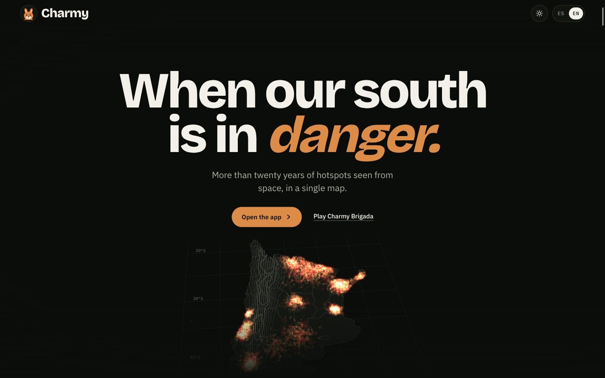
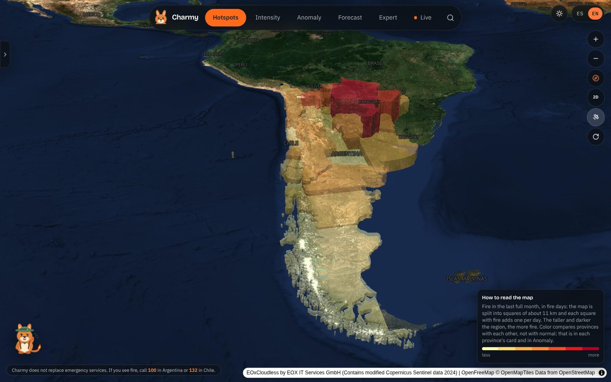
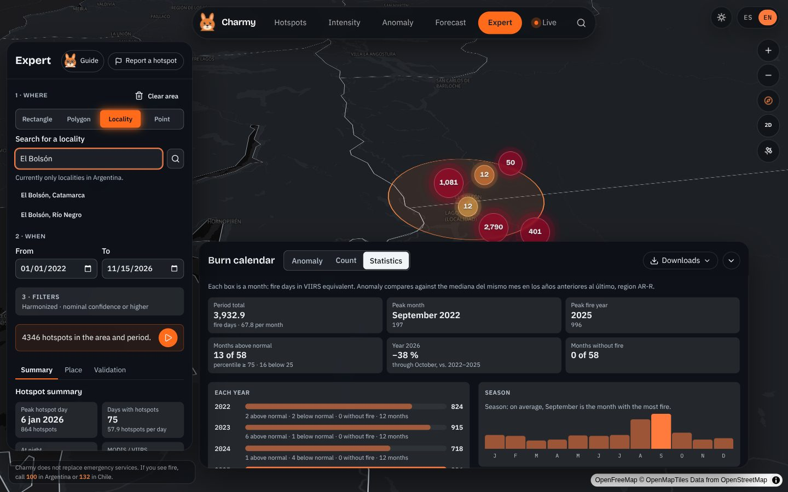
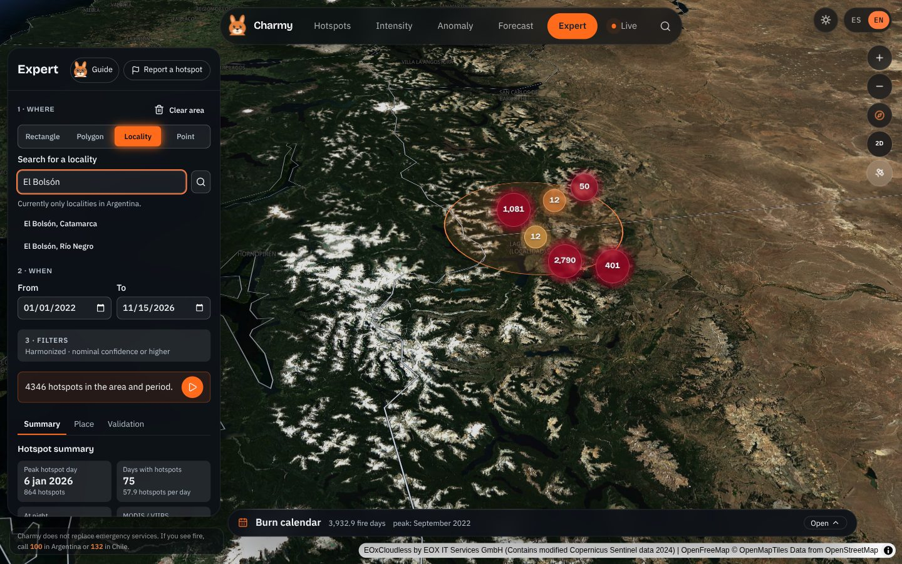
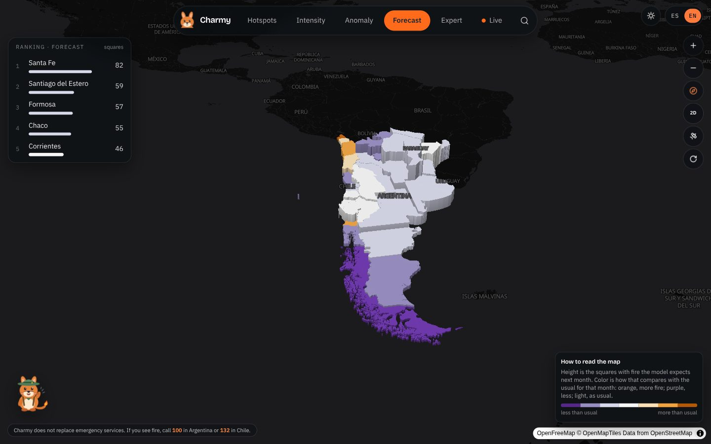
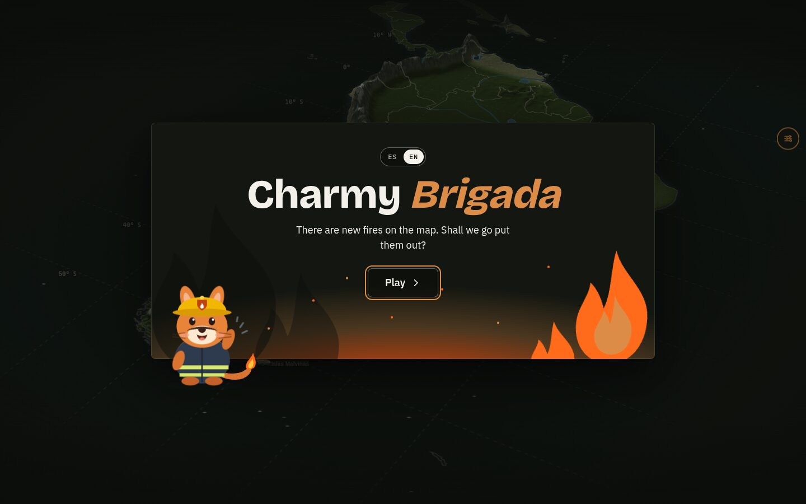
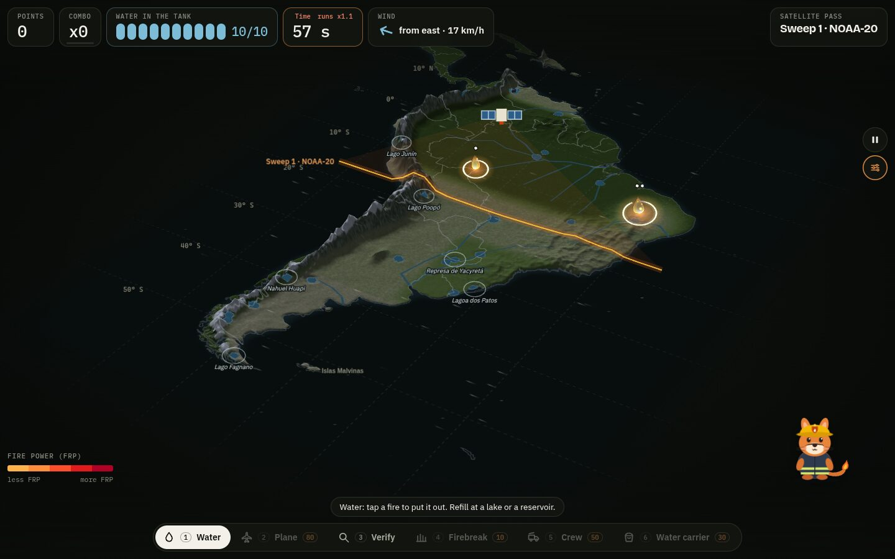
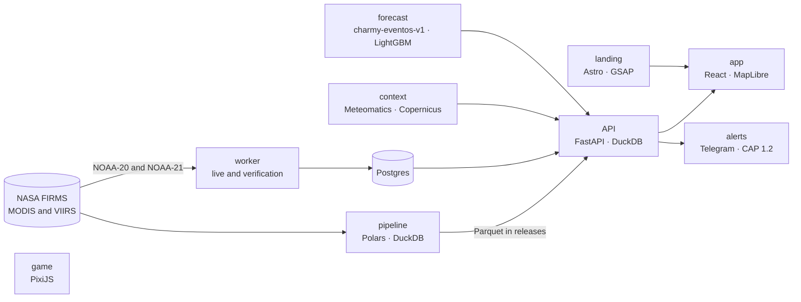

<div align="center">


# Charmy

**More than twenty years of hotspots seen from space, in a single map.**

Charmy merges MODIS and VIIRS hotspots into one continuous series since 2001 and shows it as a burn calendar on a 2D
and 3D map of Argentina and Chile. A fire vizcacha guides the public; the expert mode serves fire crews and
researchers.

[**Open the app**](https://app.charmy.earth) · [Landing](https://charmy.earth/?idioma=en) · [Play Charmy Brigada](https://juego.charmy.earth/?idioma=en) · [API](https://api.charmy.earth/api/v1/health) · [Method (Spanish)](docs/metodologia/README.md)

NASA Space Apps Challenge 2026 · Challenge *Harmonization of MODIS and VIIRS Hot Spots* · Comodoro Rivadavia, Argentina

[Español](README.md) · **English**

</div>



## The problem

Satellites change, but fire has to stay comparable year after year. MODIS has observed since 2000 with 1 km pixels;
VIIRS, since 2012, with 375 m pixels. VIIRS sees many more hotspots, so a series that moves from one sensor to the
other seems to show more fire even when there is none. Without harmonization, the source sensor changes how trends and
anomalies read.

## What Charmy does

- **One series, from 2001 to today.** 17.5 million hotspots from five satellites brought to the same scale, with a
  confidence interval for every converted month and the sensor it came from.
- **A burn calendar** by month and year, for any province, locality, rectangle or polygon you draw, with the anomaly
  against the historical median and a statistics view: each year, the season, the latest year against the previous
  ones and which sensor each month comes from.
- **A 3D map** of 39 provinces and regions of Argentina and Chile where height is fire: hotspots, intensity, anomaly,
  forecast and live hotspots, over the map or over Sentinel-2 satellite imagery.
- **Live hotspots** from NOAA-20 and NOAA-21, verified with several signals (satellite confidence, fixed sources, news
  and reports from people), with the local weather and a Sentinel-2 image as context.
- **One- to six-month forecasts**: the probability of fire in each 11 km square, by province or for the area you draw.
  Published only because it beats climatology on months the model never saw.
- **Alerts** on three Telegram channels ([Comarca Andina](https://t.me/+29kxDW2TpcVlMDY5),
  [Northern Salta](https://t.me/+ABJdg2Zmsko4OTcx) and [Impenetrable chaqueño](https://t.me/+5kIYhu5NmCthMmVh)), a CAP
  1.2 feed for agencies and hotspot reports without creating an account.
- **CSV download** with the same header as FIRMS.
- **Charmy Brigada**, a game to learn how a hotspot is detected and fought.
- In **Spanish and English**, with light and dark themes and color-blind-safe color ramps.

## Charmy, the fire vizcacha

Charmy comes along in every part of the product and dresses for each job: waves on the landing page, guides the tours,
puts on a lab coat for expert mode, a helmet for alerts and goggles for the game's water bomber. Charmy speaks briefly,
directly to you and without alarmism, and always reminds you which number to call.

<table>
  <tr>
    <td align="center"><br><sub><b>Base</b><br>the landing page</sub></td>
    <td align="center"><br><sub><b>Guide</b><br>the tours</sub></td>
    <td align="center"><br><sub><b>Scientist</b><br>expert mode</sub></td>
    <td align="center"><br><sub><b>Firefighter</b><br>alerts and the game</sub></td>
    <td align="center"><br><sub><b>Pilot</b><br>the water bomber</sub></td>
  </tr>
</table>

And changes mood with what happens on screen:

<table>
  <tr>
    <td align="center"><br><sub>waits</sub></td>
    <td align="center"><br><sub>waves</sub></td>
    <td align="center"><br><sub>explains</sub></td>
    <td align="center"><br><sub>thinks</sub></td>
    <td align="center"><br><sub>alerts</sub></td>
    <td align="center"><br><sub>celebrates</sub></td>
  </tr>
</table>

Every one of these images is drawn by the same component the app uses ([`packages/charmy/`](packages/charmy/)): one
drawing, five outfits and six moods, with no hand-made copies.

## Tour

### The map: height is fire

Each province rises with its fire days in the last full month. The ranking on the left and the legend on the right
explain what you see; Charmy offers a guided tour on every tab.


### Every province, explained

Tap a province and Charmy sums it up: fire this month, intensity in megawatts, how it compares with normal, the last
month day by day, its rank among the 39 regions and its typical season.


### Satellite view

One button swaps the map for the cloudless Sentinel-2 mosaic (EOxCloudless 2024), in 2D or 3D and on every tab. The
provinces turn transparent so you can see the land under the fire: the green Chaco, the snowy Andes, the Patagonian
steppe.



### Expert mode and the burn calendar

Pick an area (rectangle, polygon, locality or point), the dates and the sensor and confidence filters. Charmy clusters
the hotspots on the 3D map (or in 2D, lighter), which tilts and rotates like any map, and builds the burn calendar month
by month:

- **Anomaly** and **Count**: the grid of years and months, with color-blind-safe colors and the value in every box.
- **Statistics**: the period total, the peak month, the year with the most fire, the months above normal and without
  fire, the latest year against the previous ones up to the same month, each year's total, the season and which sensor
  each month comes from.
- The calendar **minimizes** to a bar with the total and the peak month when you want to see the whole map.

You can download the hotspots as CSV and GeoJSON and the calendar as CSV or as an image. The *Place* tab brings the
weather, the satellite image and the area forecast; *Validation* shows how well the harmonization works in that
region.


<p>
  
  
</p>

### Forecast against the usual

Height is the number of 11 km squares the model expects to have fire next month; color says whether that is more or
less than usual for that month. Each province carries the next six months: the first two as a forecast and the third
to the sixth as the adjusted usual, because at that range the model does not always beat climatology.



### Live

Hotspots from the last 6, 24 or 48 hours, by satellite, clustered on the 3D map, where each province rises with its
hotspots, with controls to zoom in, zoom out, face north and switch to 2D. Each one carries its intensity and its
verification status: confirmed, probable, unconfirmed or probable fixed source.


### Charmy Brigada

A short game on a 3D model of South America. The satellite passes, hotspots appear, and you verify them and put them
out with water, planes, firebreaks and crews, watching the wind and refilling at lakes and reservoirs.

<p>
  
  
</p>

## Why you can trust the numbers

### A simple, measured method

Charmy counts **fire days** (cell-days with fire): a 0.1° cell (about 11 km) with at least one hotspot on a given day
counts 1. That way it does not matter how many pixels or satellite passes saw that fire, and the resolution gap
between sensors shrinks. What remains is corrected with a straight line on a log scale, fitted region by region and
month by month over the years when the sensors overlap.

Before counting, **fixed sources** (370 cells of industry and gas flares) and low-confidence hotspots are removed. No
step uses AI: these are fixed rules and regressions anyone can review.

### Cross-validation

For each overlap year, the model is calibrated without that year and predicts its months:

| Conversion | r² (median across regions) | Relative bias | Mean absolute error |
|---|---|---|---|
| MODIS → VIIRS S-NPP | **0.90** | −4.6 % | 10.5 fire days per month |
| NOAA-20 → VIIRS S-NPP | **0.94** | −0.7 % | 7.3 fire days per month |

### Against the fires everyone remembers

| Documented event | What Charmy shows |
|---|---|
| Corrientes, January and February 2022 (934,238 ha according to INTA) | About 10 and 6 times the median for those months. Ranked 10th and 9th among 310 months |
| Paraná Delta, August 2020 | 4.8 times the median: the second-highest month in Entre Ríos |
| Chile, February 2023 (428,343 ha according to CONAF) | The highest month in Biobío in the whole series |
| Chile, 2023-2024 season (83 % less area according to CONAF) | The lowest season for Chile in the series: 24th of 24 |

Charmy measures burning activity, not hectares, and says so: a huge, continuous fire can add up to fewer fire days
than many small agricultural burns. The limits of the method are written down in
[`docs/metodologia/`](docs/metodologia/README.md) (Spanish).

### A forecast that had to earn its place

No model is published unless it beats climatology (the historical frequency of each place in each month) on months it
never saw in training (D-10).

The app shows **`charmy-eventos-v1`**: the probability that each 0.1° square has a fire event in a month, one to six
months ahead, with one LightGBM per horizon and isotonic calibration. It uses only the hotspot history from the five
satellites; NASA POWER climate data was tested and did not help, so it was left out. Over 24 never-seen months
(November 2024 to October 2026):

| Horizon | Model AUC | Climatology AUC | Error improvement (Brier) | Worst year |
|---|---|---|---|---|
| 1 month | **0.92** | 0.86 | **13 %** | 9 % |
| 2 months | **0.92** | 0.86 | **12 %** | −1 % |
| 3 to 6 months | 0.91 | 0.86 | 8 % to 10 % | −4 % to −7 % |

At three months or more some years were worse than climatology, so those horizons are shown as the adjusted usual and
not as a forecast. The model runs as a separate service that only the API calls, with a token (D-40). Details in
[`services/prediccion/entrenamiento/`](services/prediccion/entrenamiento/REPORTE.md) (Spanish).

The API also publishes a per-region series with LightGBM and p10–p90 quantiles (`/forecast`): at one month, Poisson
deviance drops **35 %** against climatology. TimesFM 2.5 and 3.0 were tested and are not published: they lowered the
mean error by predicting almost always zero.

### Live, without letting AI decide alone

Each live hotspot is crossed with several signals: satellite confidence, whether it falls on a fixed source, news from
its province and reports from people nearby. A language model (NVIDIA's Nemotron 3.5 Bolt) only labels headlines, and
a news item supports a hotspot only if it is about fire in vegetation or in the open in that province: houses, cars or
explosions do not count. Measured on real headlines, it got 36 out of 36 right. The verdict comes from fixed rules over
all signals, and a lack of news never turns a hotspot into a false one (D-09). To
understand the place, Charmy adds wind, humidity and fire risk from Meteomatics and the clearest Sentinel-2 image from
Copernicus. If a source goes down, that part shows as unavailable and the rest keeps working.

## How it is built



| Layer | Technologies |
|---|---|
| Data | Python 3.12, Polars, DuckDB, GeoPandas, Parquet published in GitHub releases with `manifest.json` and `sha256` |
| API | FastAPI, DuckDB over Parquet via HTTPS, Postgres (Supabase), OpenAPI 3.1 contract with mock and Postman collection |
| App | Vite, React, TypeScript, Tailwind v4, TanStack Query, Zustand, MapLibre GL, Terra Draw, Turf, Observable Plot |
| Landing and game | Astro, GSAP, Lenis; PixiJS 8 with Web Audio sounds |
| Forecast | `charmy-eventos-v1`: one LightGBM per horizon with isotonic calibration, in a separate FastAPI service on Render; LightGBM with p10–p90 quantiles per region |
| Alerts | Telegram bot (aiogram) with one channel per zone and OASIS CAP 1.2 feed |
| Platform | pnpm + Turborepo and uv monorepo, GitHub Actions, Cloudflare Pages, Docker on Render |

FIRMS, Meteomatics and Copernicus keys live only on the server, with caching and within each service's limits. The
browser never sees them.

## Five people, five agents, 36 hours

Charmy was built over the competition weekend by a team of five people, each with their own coding agent (Claude Code
and others). The agents coordinate on a [board](https://github.com/cosmosnehu77/Charmy/issues/1): a pinned issue
where they post what changed, ask for other people's folders and announce contracts. Each person owns a lane of
folders, each task is an issue and every change goes in through a PR.

- **Over 210 merged PRs** and over 170 issues, each tied to a requirement in [`REQUISITOS.md`](REQUISITOS.md) and a task
  in [`PLAN.md`](PLAN.md).
- **Close to 800 automated tests** in 88 files. Done means tested: every commit runs the tests for what it touches, and
  nothing reaches `main` with a red CI ([`docs/PRUEBAS.md`](docs/PRUEBAS.md)).
- **No test calls an external service**: they use recorded responses and also test failures (timeouts, 429, 5xx).
- **Public repo since the first commit**, without a single key in the history.
- **Handoff** when someone runs out of token usage: the work moves to another person without getting lost
  ([`AGENTS.md`](AGENTS.md), section 7).

The coordination template is open: [tabla-agentes](https://github.com/cosmosnehu77/tabla-agentes).

### The team

| | Person | Lane |
|---|---|---|
|  | Nehuén ([@cosmosnehu77](https://github.com/cosmosnehu77)) | Lead: platform, deployment and coordination |
|  | Leonel ([@leonelcnr](https://github.com/leonelcnr)) | Data: pipeline, harmonization and method |
|  | Bruno ([@BrunoAguinaga0](https://github.com/BrunoAguinaga0)) | Backend: API and live hotspots |
|  | Daniel ([@daniace](https://github.com/daniace)) | App, landing and game |
|  | Angelo ([@dimidio6](https://github.com/dimidio6)) | Alerts and forecast |

## What is in the repo

The code, the documents and the folder names are in Spanish.

| Folder | What it is |
|---|---|
| [`apps/app/`](apps/app/) | The application: 2D and 3D map, calendar, forecast, live and expert mode. |
| [`apps/landing/`](apps/landing/) | The landing page. |
| [`apps/juego/`](apps/juego/) | Charmy Brigada, the game. |
| [`packages/charmy/`](packages/charmy/) | The `<Charmy mood outfit size say />` component, the only way to show Charmy. |
| [`packages/ui/`](packages/ui/) | Colors, typefaces and color-blind-safe ramps. |
| [`packages/contracts/api/`](packages/contracts/api/) | The API's OpenAPI contract, its mock and the Postman collection. |
| [`packages/contracts/datos/`](packages/contracts/datos/) | Data schema (hotspots, calendar, series, metrics and forecast). |
| [`services/pipeline/`](services/pipeline/) | FIRMS loading into Parquet, harmonization, calendar and metrics. |
| [`services/api/`](services/api/) | The API. |
| [`services/worker/`](services/worker/) | Recent NOAA-20 and NOAA-21 hotspots and their multi-signal verification. |
| [`services/contexto/`](services/contexto/) | Weather (Meteomatics) and satellite imagery (Copernicus) for a hotspot. |
| [`services/prediccion/`](services/prediccion/) | Forecast model and its training. |
| [`services/alertas/`](services/alertas/) | Telegram alerts and CAP 1.2 feed. |
| [`docs/charmy/`](docs/charmy/) | Charmy's images in this README, generated with the component (`node docs/charmy/generar.mjs`). |
| [`data/muestras/`](data/muestras/) | Small samples shaped like the real data. The full data is published outside the repo. |
| [`infra/`](infra/) | Data publishing and smoke test. |

## Running it locally

Requirements: Node 22 or later, pnpm, uv and Docker.

```bash
pnpm install
uv sync --all-packages
cp .env.example .env
pnpm dev --filter @charmy/app
```

In development the app uses the contract mock (`apps/app/.env.development`), started with
`pnpm --filter @charmy/contracts-api mock`. To use the local or production API, set `VITE_API_URL` (with `/api/v1`) in
`apps/app/.env.development.local`.

```bash
pnpm check                 # types, tests and build for the whole monorepo
uv run pytest services infra
```

The API runs on a free plan that sleeps: the first request can take about a minute.

**Data.** Precomputed data is published as GitHub releases with a `manifest.json` listing each file with its size and
`sha256` ([`infra/README.md`](infra/README.md)). Releases are never overwritten.

**Smoke test.** Checks that a deployed API meets the contract (`/health`, `/calendar` and the `/hotspots` CSV). It runs
in CI against the mock and after every deployment against production. By hand:

```bash
uv run --package humo python -m humo https://<host>/api/v1
```

## Use of artificial intelligence

- **Data and harmonization:** no AI. Fixed rules and linear regressions ([method](docs/metodologia/README.md)).
- **Forecast:** machine learning (LightGBM, in `charmy-eventos-v1` and in the per-region series). Shown only if it beats
  climatology on test months it never saw (D-10, D-40).
- **Live hotspot verification:** a language model (NVIDIA's Nemotron 3.5 Bolt) only labels news headlines. The verdict comes
  from fixed rules over several signals (D-09).
- **Development:** the code and documentation were written with coding agents (Claude Code and others), coordinated
  through the board and reviewed by the team. Every feature goes in with its tests.

## Data and credits

Hotspots: [NASA FIRMS](https://firms.modaps.eosdis.nasa.gov/) (MODIS and VIIRS). Weather:
[Meteomatics](https://www.meteomatics.com/). Imagery: contains modified Copernicus Sentinel data
([Copernicus Data Space](https://dataspace.copernicus.eu/)). Boundaries: [Natural Earth](https://www.naturalearthdata.com/).
Localities: Georef API from datos.gob.ar. Base map: OpenFreeMap, OpenMapTiles and OpenStreetMap. Terms of use for each
source: [`PLAN.md`](PLAN.md), section 1.1.

> **Charmy does not replace emergency services.** If you see fire, call **100** (firefighters, Argentina) or **132**
> (firefighters, Chile).
