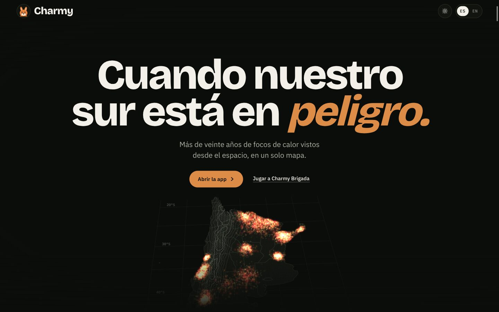
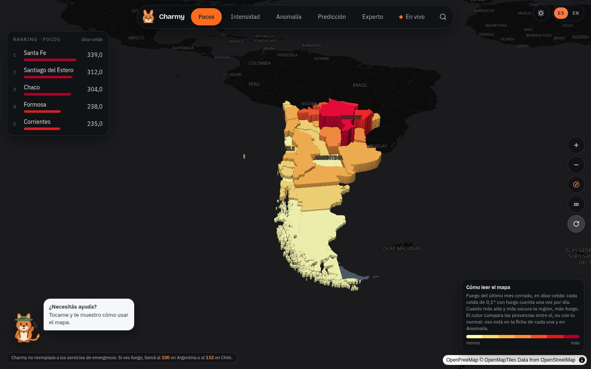
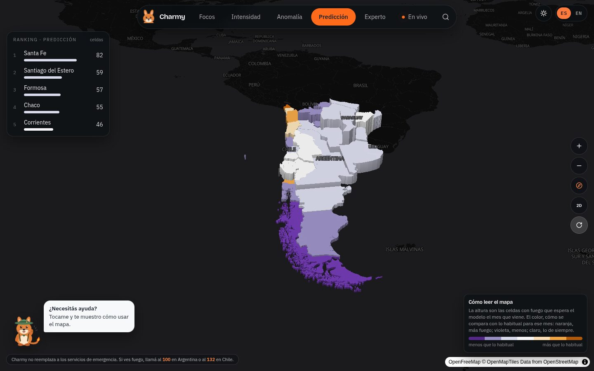
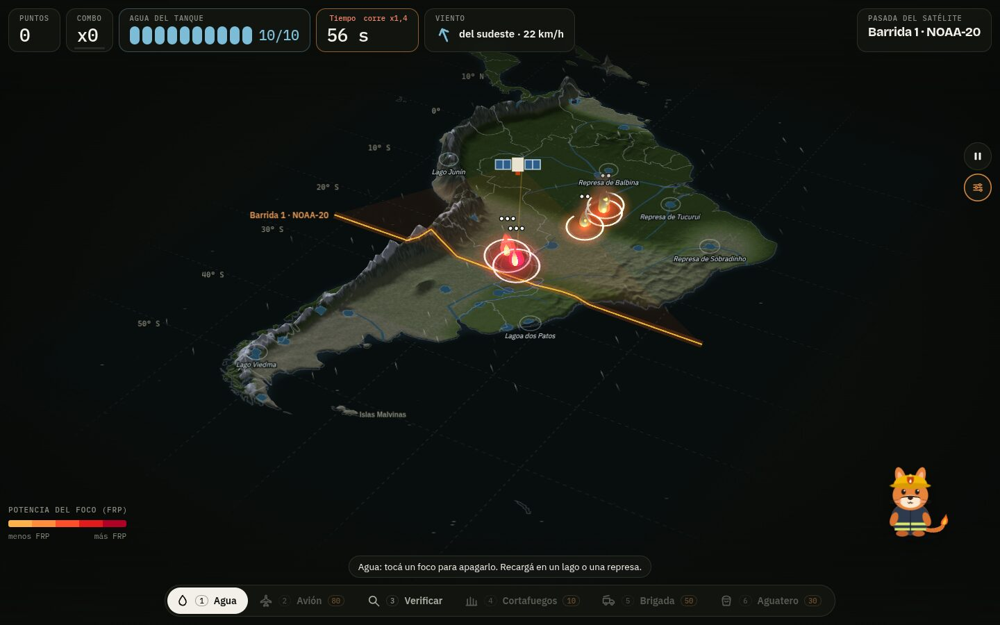
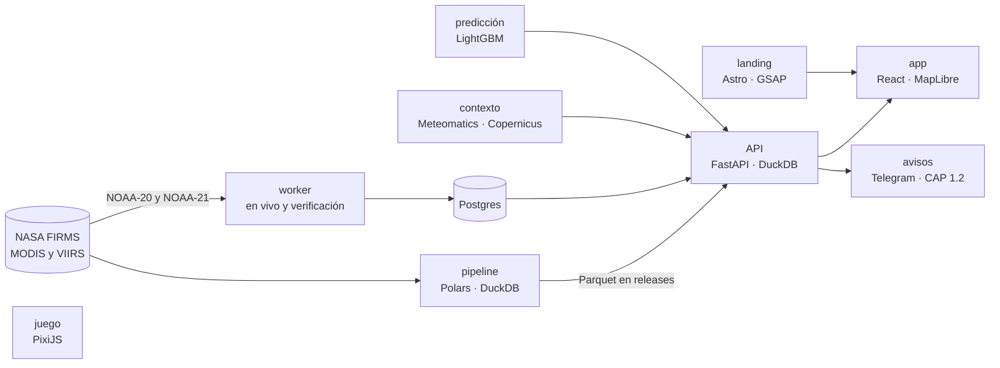

<div align="center">


# Charmy

**Más de veinte años de focos de calor vistos desde el espacio, en un solo mapa.**

Charmy une los focos de calor de MODIS y VIIRS en una sola serie continua desde 2001 y la muestra como calendario de
quema sobre un mapa 2D y 3D de Argentina y Chile. Una vizcacha de fuego guía al público; el modo experto sirve a
brigadas e investigadores.

[**Abrir la app**](https://app.charmy.earth) · [Landing](https://charmy.earth) · [Jugar a Charmy Brigada](https://juego.charmy.earth) · [API](https://api.charmy.earth/api/v1/health) · [Método](docs/metodologia/README.md)

NASA Space Apps Challenge 2026 · Desafío *Harmonization of MODIS and VIIRS Hot Spots* · Comodoro Rivadavia, Argentina

**Español** · [English](README.en.md)

</div>



## El problema

Los satélites cambian, pero el fuego hay que poder compararlo año contra año. MODIS observa desde el 2000 con píxeles de
1 km; VIIRS, desde 2012, con píxeles de 375 m. VIIRS ve muchos más focos, así que una serie que pasa de un sensor al
otro parece mostrar más fuego aunque no lo haya. Sin armonizar, el sensor de origen cambia la lectura de tendencias y
anomalías.

## Lo que hace Charmy

- **Una sola serie, de 2001 a hoy.** 17,5 millones de focos de cinco satélites llevados a una misma escala, con el
  intervalo de confianza de cada mes convertido y el sensor del que salió.
- **Un calendario de quema** por mes y por año, para cualquier provincia, localidad, rectángulo o polígono que dibujes,
  con la anomalía contra la mediana histórica.
- **Un mapa 3D** de 39 provincias y regiones de Argentina y Chile en el que la altura es el fuego: focos, intensidad,
  anomalía, predicción y focos en vivo.
- **Focos en vivo** de NOAA-20 y NOAA-21, verificados con varias señales (confianza del satélite, fuentes fijas,
  noticias y reportes de la gente), con el tiempo y la imagen Sentinel-2 del lugar como contexto.
- **Predicción a uno y dos meses** que solo se publica porque le gana a la climatología en años que no vio.
- **Avisos** por Telegram y un feed CAP 1.2 para entidades, y reportes de foco sin crear cuenta.
- **Descarga en CSV** con el mismo encabezado de FIRMS.
- **Charmy Brigada**, un juego para aprender cómo se detecta y se combate un foco.
- En **español e inglés**, con tema claro y oscuro y rampas de color aptas para daltonismo.

## Recorrido

### El mapa: la altura es el fuego

Cada provincia sube según los días-celda con fuego del último mes cerrado. El ranking de la izquierda y la leyenda de
la derecha explican lo que se ve; Charmy ofrece un recorrido guiado.



### La ficha de cada provincia

Tocás una provincia y Charmy la resume: fuego del mes, intensidad en megavatios, comparación con lo normal, el último
mes día por día, su puesto entre las 39 regiones y la temporada típica.


### El modo experto y el calendario de quema

Elegís un área (rectángulo, polígono, localidad o punto), las fechas y los filtros de sensor y confianza. Charmy
agrupa los focos sobre el mapa en 3D (o en 2D, más liviano) y arma el calendario de quema mes por mes, con la anomalía
o la cantidad, el mes pico, la temporada y la descarga de los datos. La pestaña *Validación* muestra qué tan bien
funciona la armonización en esa región.


### Predicción contra lo habitual

La altura es el fuego que espera el modelo para el mes que viene; el color dice si es más o menos que lo habitual
para ese mes.



### En vivo

Los focos de las últimas 6, 24 o 48 horas, por satélite, agrupados sobre el mapa 3D, donde cada provincia sube según
sus focos. Cada uno trae su intensidad y su estado de verificación: confirmado, probable, sin confirmar o probable
fuente fija.


### Charmy Brigada

Un juego corto sobre una maqueta 3D de Sudamérica. Pasa el satélite, aparecen focos, y hay que verificarlos y
apagarlos con agua, aviones, cortafuegos y brigadas, mirando el viento y recargando en lagos y represas.

<p>
  
  
</p>

## Por qué podés confiar en los números

### Un método simple y medido

Charmy cuenta **días-celda con fuego**: una celda de 0,1° (unos 11 km) que tuvo al menos un foco en un día cuenta 1.
Así no importa cuántos píxeles ni cuántas pasadas de satélite vieron ese fuego, y la diferencia de resolución entre
sensores se achica. Lo que queda se corrige con una recta en escala logarítmica, aprendida región por región y mes por
mes en los años en que los sensores coinciden.

Antes de contar se sacan las **fuentes fijas** (370 celdas de industria y antorchas de gas) y los focos de baja
confianza. Ningún paso usa IA: son reglas fijas y regresiones que cualquiera puede revisar.

### Validación cruzada

Para cada año de solape se calibra sin ese año y se predicen sus meses:

| Conversión | r² (mediana entre regiones) | Sesgo relativo | Error medio absoluto |
|---|---|---|---|
| MODIS → VIIRS S-NPP | **0,90** | −4,6 % | 10,5 días-celda por mes |
| NOAA-20 → VIIRS S-NPP | **0,94** | −0,7 % | 7,3 días-celda por mes |

### Contra los incendios que todos recordamos

| Evento documentado | Qué muestra Charmy |
|---|---|
| Corrientes, enero y febrero de 2022 (934.238 ha según el INTA) | Unas 10 y 6 veces la mediana de esos meses. Puestos 10 y 9 entre 310 meses |
| Delta del Paraná, agosto de 2020 | 4,8 veces la mediana: el segundo mes más alto de Entre Ríos |
| Chile, febrero de 2023 (428.343 ha según CONAF) | El mes más alto de Biobío en toda la serie |
| Chile, temporada 2023-2024 (83 % menos superficie según CONAF) | La temporada más baja de Chile en la serie: puesto 24 de 24 |

Charmy mide actividad de quema, no hectáreas, y lo dice: un incendio enorme y continuo puede sumar menos días-celda que
muchas quemas agrícolas chicas. Los límites del método están escritos en [`docs/metodologia/`](docs/metodologia/README.md).

### Una predicción que tuvo que ganarse el lugar

LightGBM se compara con la climatología en 2025 y 2026, años que no vio al entrenar, y un plazo se publica solo si la
mejora (D-10). A un mes, el desvío de Poisson baja **35 %** y, en el 10 % de celdas de mayor riesgo, acierta el 58 %
contra el 52 % de la climatología. El plazo de tres meses no pasó la prueba y no se muestra. También se probaron
TimesFM 2.5 y 3.0: mejoraban el error medio prediciendo casi siempre cero, así que no se publican.

### En vivo, sin que la IA decida sola

Cada foco en vivo se cruza con varias señales: la confianza del satélite, si cae en una fuente fija, las noticias de
su provincia y los reportes de la gente cerca. Un modelo de lenguaje (Nemotron, de NVIDIA) solo etiqueta titulares; el
veredicto sale de reglas fijas sobre todas las señales, y la falta de noticias nunca convierte un foco en falso (D-09).
Para entender el lugar, Charmy suma el viento, la humedad y el riesgo de incendio de Meteomatics y la imagen
Sentinel-2 más despejada de Copernicus.
Si una fuente se cae, esa parte se muestra como no disponible y el resto sigue andando.

## Cómo está hecho



| Capa | Tecnologías |
|---|---|
| Datos | Python 3.12, Polars, DuckDB, GeoPandas, Parquet publicado en releases de GitHub con `manifest.json` y `sha256` |
| API | FastAPI, DuckDB sobre Parquet por HTTPS, Postgres (Supabase), contrato OpenAPI 3.1 con mock y colección de Postman |
| App | Vite, React, TypeScript, Tailwind v4, TanStack Query, Zustand, MapLibre GL, Terra Draw, Turf, Observable Plot |
| Landing y juego | Astro, GSAP, Lenis; PixiJS 8 con sonidos de Web Audio |
| Predicción | LightGBM con cuantiles p10–p90 |
| Avisos | Bot de Telegram (aiogram) y feed OASIS CAP 1.2 |
| Plataforma | Monorepo pnpm + Turborepo y uv, GitHub Actions, Cloudflare Pages, Docker en Render |

Las claves de FIRMS, Meteomatics y Copernicus viven solo en el servidor, con caché y dentro de los límites de cada
servicio. El navegador nunca las ve.

## Cinco personas, cinco agentes, 36 horas

Charmy se hizo en el fin de semana de la competencia con un equipo de cinco personas, cada una con su agente de
programación (Claude Code y otros). Los agentes se coordinan en un [tablero](https://github.com/cosmosnehu77/Charmy/issues/1):
un issue fijado donde publican qué cambió, piden carpetas ajenas y anuncian contratos. Cada persona tiene un carril de
carpetas propio, cada tarea es un issue y cada cambio entra por un PR.

- **Más de 200 PR fusionados** y más de 150 issues, todos atados a un requisito de [`REQUISITOS.md`](REQUISITOS.md) y a
  una tarea de [`PLAN.md`](PLAN.md).
- **Más de 750 pruebas automáticas** en 87 archivos. Terminado es probado: cada commit corre las pruebas de lo que toca
  y nada entra a `main` con el CI en rojo ([`docs/PRUEBAS.md`](docs/PRUEBAS.md)).
- **Ninguna prueba llama a un servicio externo**: se usan respuestas grabadas y se prueban también las fallas (tiempo
  agotado, 429, 5xx).
- **Repo público desde el primer commit**, sin una sola clave en el historial.
- **Relevo** cuando una persona se queda sin uso de tokens: el trabajo pasa a otra sin perderse
  ([`AGENTS.md`](AGENTS.md), sección 7).

La plantilla de coordinación es abierta: [tabla-agentes](https://github.com/cosmosnehu77/tabla-agentes).

### El equipo

| | Persona | Carril |
|---|---|---|
|  | Nehuén ([@cosmosnehu77](https://github.com/cosmosnehu77)) | Líder: plataforma, despliegue y coordinación |
|  | Leonel ([@leonelcnr](https://github.com/leonelcnr)) | Datos: pipeline, armonización y método |
|  | Bruno ([@BrunoAguinaga0](https://github.com/BrunoAguinaga0)) | Backend: API y focos en vivo |
|  | Daniel ([@daniace](https://github.com/daniace)) | App, landing y juego |
|  | Angelo ([@dimidio6](https://github.com/dimidio6)) | Avisos y predicción |

## Qué hay en el repo

| Carpeta | Qué es |
|---|---|
| [`apps/app/`](apps/app/) | La aplicación: mapa 2D y 3D, calendario, predicción, en vivo y modo experto. |
| [`apps/landing/`](apps/landing/) | La landing. |
| [`apps/juego/`](apps/juego/) | Charmy Brigada. |
| [`packages/charmy/`](packages/charmy/) | El componente `<Charmy mood outfit size say />`, la única forma de mostrar a Charmy. |
| [`packages/ui/`](packages/ui/) | Colores, tipografías y rampas aptas para daltonismo. |
| [`packages/contracts/api/`](packages/contracts/api/) | Contrato OpenAPI de la API, su mock y la colección de Postman. |
| [`packages/contracts/datos/`](packages/contracts/datos/) | Esquema de los datos (focos, calendario, series, métricas y predicción). |
| [`services/pipeline/`](services/pipeline/) | Carga de FIRMS a Parquet, armonización, calendario y métricas. |
| [`services/api/`](services/api/) | La API. |
| [`services/worker/`](services/worker/) | Focos recientes de NOAA-20 y NOAA-21 y su verificación con varias señales. |
| [`services/contexto/`](services/contexto/) | Tiempo (Meteomatics) e imagen satelital (Copernicus) de un foco. |
| [`services/prediccion/`](services/prediccion/) | Modelo de predicción y su entrenamiento. |
| [`services/alertas/`](services/alertas/) | Avisos por Telegram y feed CAP 1.2. |
| [`data/muestras/`](data/muestras/) | Muestras chicas con la forma de los datos reales. Los datos completos se publican fuera del repo. |
| [`infra/`](infra/) | Publicación de los datos y prueba de humo. |

| Documento | Qué dice |
|---|---|
| [`REQUISITOS.md`](REQUISITOS.md) | Qué tiene que hacer Charmy y para quién. |
| [`PLAN.md`](PLAN.md) | Cómo, quién y cuándo: tecnologías, decisiones, fases y tareas. |
| [`docs/metodologia/`](docs/metodologia/README.md) | Armonización, validación, contraste y supuestos. |
| [`AGENTS.md`](AGENTS.md) y [`CLAUDE.md`](CLAUDE.md) | Reglas que siguen los agentes del equipo. |
| [`docs/PRUEBAS.md`](docs/PRUEBAS.md) | Cuándo una tarea está terminada. |
| [`docs/SEGURIDAD.md`](docs/SEGURIDAD.md) | Modelo de seguridad del tablero de agentes. |
| [`docs/charmy-base/`](docs/charmy-base/) | Diseño aprobado de la mascota. |

## Correrlo en local

Requisitos: Node 22 o más, pnpm, uv y Docker.

```bash
pnpm install
uv sync --all-packages
cp .env.example .env
pnpm dev --filter @charmy/app
```

En desarrollo la app usa el mock del contrato (`apps/app/.env.development`), que se levanta con
`pnpm --filter @charmy/contracts-api mock`. Para usar la API local o la de producción, poné `VITE_API_URL` (con
`/api/v1`) en `apps/app/.env.development.local`.

```bash
pnpm check                 # tipos, pruebas y compilación de todo el monorepo
uv run pytest services infra
```

La API corre en un plan gratuito que se duerme: el primer pedido puede tardar cerca de un minuto.

**Datos.** Los datos precalculados se publican como versiones (releases) de GitHub con un `manifest.json` que lista cada
archivo con su tamaño y su `sha256` ([`infra/README.md`](infra/README.md)). Las versiones no se pisan.

**Prueba de humo.** Comprueba que una API desplegada cumple el contrato (`/health`, `/calendar` y el CSV de
`/hotspots`). Corre en el CI contra el mock y después de cada despliegue contra producción. A mano:

```bash
uv run --package humo python -m humo https://<host>/api/v1
```

**Sumarse al equipo.** `gh auth login`, clonar el repo y correr `tools/board check`: tiene que mostrar tu login en la
lista de permitidos. Las claves de `.env` se piden al líder por un canal privado y nunca se suben al repo.

## Uso de inteligencia artificial

- **Datos y armonización:** sin IA. Son reglas fijas y regresiones lineales ([método](docs/metodologia/README.md)).
- **Predicción:** aprendizaje automático (LightGBM). Solo se muestra si supera a la climatología en los años de prueba
  (D-10).
- **Verificación de focos en vivo:** un modelo de lenguaje (Nemotron, de NVIDIA) solo etiqueta titulares de noticias.
  El veredicto sale de reglas fijas sobre varias señales (D-09).
- **Desarrollo:** el código y la documentación se escribieron con agentes de programación (Claude Code y otros),
  coordinados por el tablero y revisados por las personas del equipo. Toda funcionalidad entra con sus pruebas.

## Datos y créditos

Focos de calor: [NASA FIRMS](https://firms.modaps.eosdis.nasa.gov/) (MODIS y VIIRS). Tiempo:
[Meteomatics](https://www.meteomatics.com/). Imagen: contiene datos modificados de Copernicus Sentinel
([Copernicus Data Space](https://dataspace.copernicus.eu/)). Límites: [Natural Earth](https://www.naturalearthdata.com/).
Localidades: API Georef de datos.gob.ar. Mapa base: OpenFreeMap, OpenMapTiles y OpenStreetMap. Condiciones de uso de
cada fuente: [`PLAN.md`](PLAN.md), sección 1.1.

> **Charmy no reemplaza a los servicios de emergencia.** Si ves fuego, llamá al **100** (bomberos, Argentina) o al
> **132** (bomberos, Chile).
